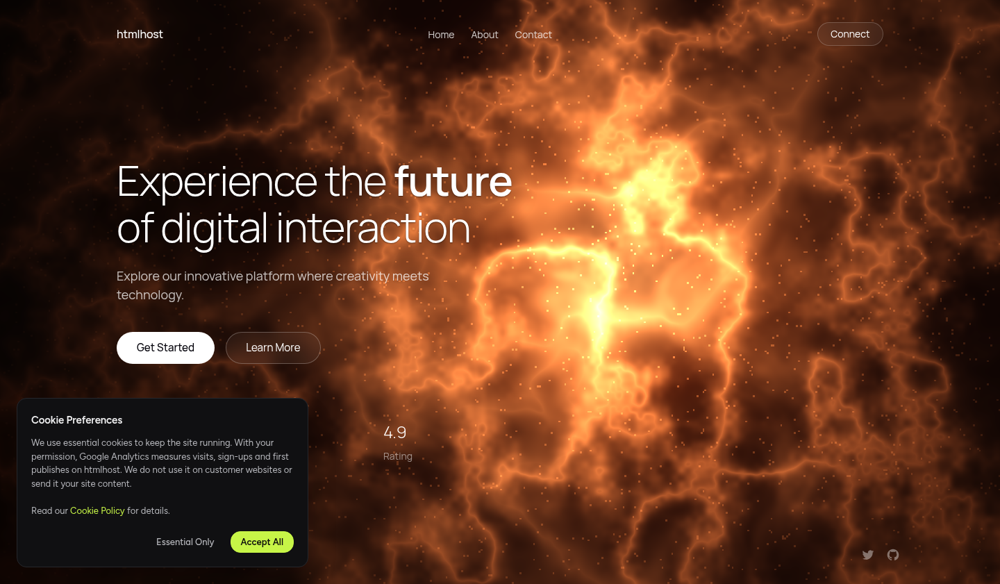

# Phase 1B Motion Deep Audit

**Status:** Complete for the five public template previews listed below. **Capture date:** 2026-11-08. **Scope:** Public sandboxed template previews only; this is not an audit of published customer sites.

## Executive finding

The five previews do not share one motion implementation. The reviewed evidence ranges from a small number of continuously running decorative loops and one directly manipulated shape, to a motion-toggle page with many sampled Web Animations API objects, a source-declared shader/canvas animation whose input path remains unresolved, a portfolio preloader/short transition, and a business-site marquee with an accessible FAQ disclosure. Source declarations describe intended or available behavior; a declaration does not establish runtime execution or library attribution.

Reduced-motion behavior is also heterogeneous. In the sampled desktop captures, Creative Playground and Business Web Studio had zero animation objects; Kinetica's 21 objects were all paused; Futuristic Dark showed a static canvas image but its actual render path and pointer handling are unresolved; Full-Stack Designer Portfolio still had two running preloader animations. These are sampled states, not global accessibility certifications.

## Scope and method

The Phase 1B corpus contains five public preview documents: Creative Playground Landing, Kinetica Motion Typography, Futuristic Dark Landing, Full-Stack Designer Portfolio, and Business Web Studio. The host and preview iframe were treated as separate layers. No published generated customer site was verified or used.

The REA CLI 6.8.0 performed one bounded, non-interactive capture of the Creative Playground `#preview` state at 1440×900. Its scenario contains only navigation and observation; it did not click a form, publish, download, or change account state. The input, raw result, and evidence id are retained in `PHASE_1B_REA_CREATIVE_SCENARIO.json` and `phase1b-evidence/rea-creative-preview.json`.

The cross-template matrix was collected with a saved Playwright harness using system Chromium (`/usr/bin/chromium`), headless mode, English locale, device scale factor 1, fresh browser contexts per run, and a bounded wait for DOMContentLoaded, host-preview stabilization, and the primary iframe body. Thirteen records cover five templates at 1440×900 under both `no-preference` and `reduce`, plus 390×844 `no-preference` captures for Creative Playground, Kinetica, and Futuristic Dark. Reversible interactions targeted one mechanism per template; focused follow-up checks resolved some DOM-state ambiguity but exposed two unresolved discrepancies.

The runtime animation inventory is the Web Animations API's sampled `document.getAnimations()` state. It can include CSS animations and transitions, but does not by itself identify the authoring library. It also does not reveal every JavaScript animation loop. RequestAnimationFrame samples are callback-cadence samples, not compositor or GPU presentation FPS.

### Evidence labels

- **VERIFIED:** directly supported by the captured public source, DOM, computed style, browser state, screenshot, or saved run record.
- **INFERRED:** plausible explanation or safe reconstruction principle supported by one or more observations, but not directly proven as HTMLhost's internal mechanism.
- **UNKNOWN:** the available public evidence cannot settle the claim.

## Cross-template comparison

| Preview | VERIFIED sampled motion | VERIFIED tested interaction | Reduced-motion observation | Main UNKNOWN |
|---|---|---|---|---|
| Creative Playground | Two sampled loops: 24 s linear marquee and 6 s linear orbit. Source describes additional motion. | One orange-shape pointer drag changed position. | Zero animation objects, versus two running in no-preference. | Other declared effects, bounds, keyboard behavior, form and carousel outcomes. |
| Kinetica | 21 animation objects at desktop and 23 at mobile; several were paused at baseline. | Motion toggle paused all 21 sampled objects and changed its label/`aria-pressed`; resume restored four running and 17 paused. | All 21 objects were paused. | Whether declared GSAP/Swiper/Howler or other packages powered any sampled behavior. |
| Futuristic Dark | Full-frame canvas visible; zero Web Animations API objects. Source declares a requestAnimationFrame/WebGL route and fallback. | A canvas-pointer test recorded zero events; a later window-level probe saw events on non-canvas ancestors. | Reduced screenshots were byte-identical; the declared still-render path is not runtime-attributed. | WebGL versus CSS fallback, canvas event delivery, visible pointer response, true frame quality. |
| Full-Stack Designer Portfolio | Three animation objects sampled: spinner and icon running; avatar-border draw finished. A short testimonial transition was measured. | A Next click was recorded, but the two capture records disagree on whether the active slide changed. | Two preloader animations still running in the reduce capture. | Reliable slide order/outcome and the page's full motion/reduced-motion policy. |
| Business Web Studio | A 40 s linear service-label track; FAQ grid-row transition and icon/reveal animations were sampled. | FAQ opened and closed with `aria-expanded` changing false→true→false. | Zero animation objects at baseline under reduce, versus one track in no-preference. | Mobile menu, theme, counter, form, and reduced-motion behavior during interactions. |

## Per-preview evidence

### Creative Playground Landing

**VERIFIED — source evidence:** The Phase 1A public-source review described GSAP entrance/reset declarations, pointer and keyboard shape movement, bounded placement, rotation/squish feedback, IntersectionObserver reveals, smooth scrolling, a Swiper process carousel, and form validation. Public declarations list GSAP, Swiper, Lucide, canvas-confetti, and JustValidate. These establish source declarations only; they do not prove a named library ran or powered a behavior.

**VERIFIED — runtime evidence:** At 1440×900 and 390×844 with no preference, the sampled animation inventory contained two running loops: `.marquee-track` at 24,000 ms linear and `.orbit-core` at 6,000 ms linear. A single orange-shape pointer drag moved its recorded rectangle from approximately `(257.78,712.15)` to `(293.91,735.28)` CSS pixels at desktop, with no reported page error. This verifies one drag, not all shapes, bounds, keyboard behavior, or visual feedback.

**VERIFIED — reduced motion:** The matched 1440×900 reduce capture reported `prefers-reduced-motion: reduce` and zero animation objects, versus two running loops in no-preference. This is a bounded sample, not proof every possible effect is suppressed.

**VERIFIED — responsive issue:** At the 390×844 outer viewport, the iframe document's reported `scrollWidth` was 1041 px while its viewport width was 390 px. Treat this as a horizontal-overflow defect or test condition to investigate, not an intended responsive behavior to reproduce.

### Kinetica Motion Typography

**VERIFIED — source evidence:** Phase 1A found seven keyframe rules, multiple animation/transform/transition declarations, a reduced-motion block, and public declarations for GSAP/ScrollTrigger/SplitText, Swiper, Howler, Lucide, and Tailwind browser. Those declarations do not establish which packages loaded or produced runtime behavior.

**VERIFIED — runtime evidence:** The no-preference desktop sample contained 21 Web Animations API objects (four running, 17 paused); the mobile sample contained 23 (six running, 17 paused). Sampled examples included staggered 750 ms linear entries with 0/−300/−600 ms delays, a 6 s gallery loop, and longer paused decorative sequences. Under desktop reduce, all 21 were paused.

**VERIFIED — direct interaction:** The page motion control changed its visible state from “MOTION ON” to “MOTION PAUSED,” changed its accessible label from “Pause page motion” to “Resume page motion,” and changed `aria-pressed` false→true. All 21 animations were paused. Resume restored the original label/state and the observed four-running/17-paused inventory. This is direct evidence that the sampled control coordinates an accessible pause/resume state; it does not validate other controls.

### Futuristic Dark Landing

**VERIFIED — source evidence:** The public preview source declares WebGL/experimental-WebGL setup, inline shaders, a fixed-seed 256×256 noise texture, full-screen triangle, pointer/touch input, requestAnimationFrame, pointer easing, ambient drift, page-visibility pause, DPR-limited sizing, a reduced-motion still-render path, and a CSS fallback. Source declarations do not prove which branch ran.

**VERIFIED — runtime evidence:** A full-frame canvas was visible at the tested desktop and phone sizes. The sampled Web Animations API inventory was zero; this does not test a JavaScript requestAnimationFrame loop. RequestAnimationFrame sampling yielded 13 callbacks in about 1.143 s at desktop (median interval 50 ms, p95 216.7 ms, maximum 250 ms) and 20 in about 1.506 s at phone size (median 16.7 ms, p95 316.7 ms, maximum 566.7 ms). These sparse callback samples are not a trustworthy FPS or presentation-smoothness measure.

**VERIFIED / unresolved — pointer:** The dedicated reduced-motion pointer test's own event counter remained zero and its before/idle/after screenshot hashes matched. A focused follow-up recorded 20 window-level pointer/mouse events whose event targets were `HEADER`, `NAV`, `DIV`, and `MAIN`; it did not establish an event delivered to the canvas handler. Therefore canvas-targeted input and visible response remain UNKNOWN. The screenshots establish identical sampled pixels, not why they were identical.

The reduced-motion screenshot consolidation and SHA-256 record are in `phase1b-evidence/screenshot-manifest.json`; two distinct no-preference comparison frames are also retained.

### Full-Stack Designer Portfolio

**VERIFIED — source evidence:** The inspected Home source declares keyframes including shine, marquee, float, reveal, menu-slide, glow, and spin, plus extensive transition/transform styles. A library marker or declaration alone does not verify active Three.js or other library execution.

**VERIFIED — runtime evidence:** Three Web Animations API objects were sampled at desktop: preloader spinner (800 ms linear) and icon (1200 ms linear) were running, while the avatar-border draw (1500 ms linear) had finished. Focused validation sampled a 0.3 s testimonial transition, with the outgoing slide at opacity zero and 20 px horizontal offset and an incoming active slide at opacity one and zero offset.

**EVIDENCE DISCREPANCY:** The primary testimonial interaction record reports that one `Next testimonial` activation left its sampled active slide unchanged. Focused follow-up reports that one click changed the active slide from the first to the third. A click and a transition-capable state are observed, but reliable ordering/behavior is not established; the reconstruction specification should leave that outcome open until a controlled repeat resolves it.

**VERIFIED — reduced motion:** The 1440×900 reduce capture still sampled the spinner and icon running; the no-preference capture also sampled two running and one finished. This is a specific potential reduced-motion shortcoming, not a full-page compliance verdict.

### Business Web Studio

**VERIFIED — source evidence:** Phase 1A source review described a semantic agency page, mobile menu, FAQ, scroll-state header, IntersectionObserver reveals, requestAnimationFrame counters, theme/localStorage state, Lucide initialization, lazy images, and reduced-motion rules. These are source-level declarations until individually exercised.

**VERIFIED — runtime evidence:** One 40,000 ms linear service-label track was running at baseline. FAQ activation changed `aria-expanded` false→true→false and sampled a panel from zero to about 109.6 px and back to zero. Computed style recorded a 500 ms `grid-template-rows` transition; the plus/minus icon used a shorter transition, and eased reveal animations were present in the sampled state.

**EVIDENCE DISCREPANCY:** The primary close capture sampled 4.2 px residual panel height, while the focused validation sampled zero. A capture during the 500 ms closing transition is plausible, but timing is not fully specified; report both observations rather than silently resolving them.

**VERIFIED — reduced motion:** At the sampled desktop baseline, reduce had zero animation objects versus one running service-label track in no-preference. The FAQ was not replayed under reduce, so interactive disclosure behavior in that preference remains UNKNOWN.

## Mechanism and library attribution

| Mechanism | Evidence status | Research interpretation |
|---|---|---|
| CSS keyframes/transitions | **VERIFIED** in preview source and sampled computed/runtime states for several templates. | A broad technique family is supported; not every declared effect was exercised. |
| Web Animations API inventory | **VERIFIED** as a snapshot of sampled animation objects and their states. | It does not identify the CSS authoring tool, third-party library, compositing path, or every JavaScript loop. |
| IntersectionObserver reveals | **VERIFIED** as source declarations in Phase 1A. | Actual threshold crossing/reveal timing was not instrumented in the five public previews; the independent demo demonstrates the generic pattern only. |
| GSAP / Swiper / Howler | **VERIFIED** as public source/metadata declarations where recorded; runtime attribution is **UNKNOWN**. | Do not describe these as libraries confirmed to power the observed motion. |
| requestAnimationFrame | **VERIFIED** by source declarations and callback sampling where recorded. | Callback cadence is not display FPS, smoothness, or GPU presentation. |
| WebGL/canvas | **VERIFIED** that a canvas was visible and that source describes WebGL and fallback branches. | Actual WebGL initialization/render path is **UNKNOWN**. |
| Pointer/touch manipulation | **VERIFIED** for the single Creative shape drag; source declares additional paths. | Futuristic Dark canvas event delivery and visual response remain **UNKNOWN**. |

## Unresolved questions and next evidence

- **UNKNOWN:** Whether any preview behavior or performance generalizes to a customer-published HTMLhost site; none was accessed.
- **UNKNOWN:** Whether the declared third-party libraries loaded and powered their respective sampled behaviors.
- **UNKNOWN:** Reliable compositor/GPU frame pacing, CPU/GPU cost, real-device touch latency, visibility-pause behavior, and repeat-run variability.
- **UNKNOWN:** Futuristic Dark WebGL versus CSS-fallback branch and canvas-specific pointer response.
- **UNKNOWN:** Portfolio testimonial ordering and reduced-motion intent; reproduce neither the disputed slide outcome nor continued preloader motion as an intentional requirement without further verification.
- **UNKNOWN:** Business FAQ final geometry under repeated close timing, and all untested menu, theme, counter, form, and navigation states.
- **Follow-up:** Retest only the disputed states with event-level logs and a fixed wait after each transition; repeat both motion preferences. A browser performance trace or Lighthouse run is a separate next phase, not implied by this Phase 1B record.

## Evidence files

- `PHASE_1B_MOTION_DEEP_AUDIT.md` — this report.
- `PHASE_1B_RUNTIME_CAPTURE.py` and `phase1b-evidence/runtime-capture-2026-11-08.json` — 13-record runtime matrix.
- `PHASE_1B_INTERACTION_CAPTURE.py`, `phase1b-evidence/interaction-capture-2026-11-08.json`, and `phase1b-evidence/follow-up-validation-2026-11-08.json` — reversible interaction records and focused follow-ups.
- `PHASE_1B_REA_CREATIVE_SCENARIO.json` and `phase1b-evidence/rea-creative-preview.json` — bounded REA capture input/result.
- `phase1b-evidence/screenshot-manifest.json` — retained images, hashes, and duplicate-frame notes.
- `PHASE_1A_PUBLIC_CORPUS_BASELINE.md` — original source-level evidence and viewports.
