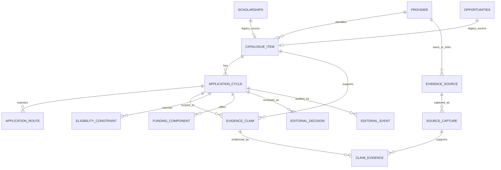

# Scholars Phase 2.1 — Technical Specification

**Date:** 2026-11-08
**Application repository revision:** `ImperioKDB/Scholars` `main` at `cf3682ce35912df7b9b9352193630fc404427c7c`
**Supabase project:** `scholarship-platform` (`cmdglabohpttgfofcmqc`, `eu-west-1`), metadata-only inspection
**Phase 2 reference commit:** `ImperioKDB/Updates` `187209aa0bca66ef8eb373657fc7534912e02887`
**Status:** Design specification only. No application code, database objects/data, grants, RLS, configuration, deployment, or provider workflow was changed.

## 1.1 Source documents and provenance

This specification refines the accepted Phase 2 baseline and controlling Phase 1.3.1 evidence; it does not supersede their record-level facts:

- [Phase 2 Catalogue Governance Policy](SCHOLARS_PHASE_2_CATALOGUE_GOVERNANCE_POLICY_2026-11-08.md)
- [Phase 2 Evidence and Data Model Design](SCHOLARS_PHASE_2_EVIDENCE_AND_DATA_MODEL_DESIGN_2026-11-08.md)
- [Phase 2 Existing Schema Compatibility Audit](SCHOLARS_PHASE_2_EXISTING_SCHEMA_COMPATIBILITY_AUDIT_2026-11-08.md)
- [Phase 2 Migration and Rollout Plan](SCHOLARS_PHASE_2_MIGRATION_AND_ROLLOUT_PLAN_2026-11-08.md)
- [Phase 2 Decision Register](SCHOLARS_PHASE_2_DECISION_REGISTER_2026-11-08.md)
- [Phase 1.3 audience, eligibility and catalogue-scope audit](SCHOLARS_PHASE_1_3_AUDIENCE_ELIGIBILITY_AND_CATALOGUE_SCOPE_AUDIT_2026-11-07.md)
- [Phase 1.3.1 audit clarification addendum](SCHOLARS_PHASE_1_3_1_HANDOFF_EXPORT_2026-11-08/SOURCE_DOCUMENTS/SCHOLARS_PHASE_1_3_1_AUDIT_CLARIFICATION_ADDENDUM_2026-11-08.md)

## 1. Goal and implementation boundary

Add a cycle-aware, evidence-backed publication decision layer without replacing current catalogues, changing existing `verified` semantics, bulk-correcting records, or breaking saves/applications/notifications. A single deterministic server-side publication evaluator must decide whether an exact cycle can be publicly listed, enter actionable matching, display an apply CTA, be saved as actionable, trigger a reminder, or be indexed. Every consumer reads the same decision envelope.

This specification is not a migration authorization. A-01–A-12 remain pending explicit approval. The broad production ACL/default-privilege finding in the Readiness Assessment is a pre-implementation security blocker, and the user’s standing instruction forbids changing RLS/permissions without explicit authorization.

## 2. Observed production and repository baseline

### 2.1 Production metadata

Read-only catalog metadata observed:

- `public.scholarships`: 95 rows; `public.opportunities`: 42; `public.scholarship_rules`: 242; `public.cycle_events`: 10. Counts are inventory metadata, not accuracy claims.
- `public.opportunities` is live despite no checked-in `CREATE TABLE opportunities` statement found in this application revision.
- Deployed enum `public.opportunity_type`: `fellowship`, `internship`, `competition`, `mentorship`, `training`.
- Current `public.opportunities` columns (21): `id uuid PK`; `type opportunity_type NOT NULL`; `title text NOT NULL`; `provider_name text NOT NULL`; `description text`; `eligibility_notes text`; `duration text`; `location text`; `compensation text`; `discipline text`; `deadline date`; `opens_at date`; `application_url text`; `how_to_apply text`; `verified boolean NOT NULL DEFAULT false`; `created_by uuid`; `research_notes text`; `created_at timestamptz NOT NULL DEFAULT now()`; `updated_at timestamptz NOT NULL DEFAULT now()`; `slug text NOT NULL`; `deadline_passed_at timestamptz`.
- Current opportunity keys/indexes include `opportunities_pkey`, unique `opportunities_slug_key`, `opportunities_created_by_fkey`, `idx_opportunities_deadline`, `idx_opportunities_type`, `idx_opportunities_verified`, verified-created and verified-deadline indexes, and `idx_opportunities_deadline_passed` partial index.
- Current triggers: `opportunities_set_catalog_slug` (before insert/update) and `set_opportunities_updated_at` (before update).
- Current policies include `opportunities_select_verified` for `anon,authenticated` with `verified=true`, `opportunities_admin_all` for authenticated admins, plus admin insert/update/delete policies. The deployed policy state differs from the initial applied SQL (which used a broader combined verified/admin SELECT policy and separate admin-write policies).

### 2.2 Deployed migration ledger and source mismatch

The live `supabase_migrations.schema_migrations` ledger contains **177 applied entries**, from `20260821182641` through `20261107115403`. Important findings:

1. The deployed base migration is `20260907051428 / create_opportunities_and_saved_opportunities`. Its stored `statements` array contains the applied CREATE TYPE, `opportunities`/`saved_opportunities` DDL, initial RLS policies, trigger, and indexes. This is authoritative history evidence and resolves the earlier question of where the base DDL came from.
2. No corresponding base `CREATE TABLE opportunities` SQL file exists in the checked-in `supabase/migrations/` directory at this revision. Recovered live statements—not an inferred local file—must be used for a schema baseline.
3. Relevant applied evolution includes `add_training_opportunity_type` (`20260909070900`), `add_public_catalog_slugs` (`20260914080258`), and `flag_expired_opportunities` (`20261002183653`), among other opportunity-related records. The live enum, `slug`, and `deadline_passed_at` confirm those later additions.
4. The final two applied ledger entries are `20261107115338 / security_boundary_remediation` and `20261107115403 / resource_center_schema`; checked-in files have prefixes `20261107130000_security_boundary_remediation.sql` and `20261107130100_resource_center_schema.sql`. The basename intent aligns, but filename timestamps are not the production migration versions.
5. The repository has duplicate numeric prefixes (`0002`, `0004`, `0006`, `0015`, `0021`, `0023`, `0034`, `0035`, `0057`, `0061`, `0062`, and others) and reference-only or differently named historical migrations. Lexical/filename order is not the deployed order. A complete one-to-one mapping of all 177 ledger rows to source files is not established by this inspection; a reviewed manifest/statement comparison is still required before migration work.

**Operational rule:** do not replay the recovered `CREATE TABLE` as a new migration, and do not insert a historical file into the active migration directory without reconciling Supabase’s version ledger. Keep recovered DDL in an explicitly archival/non-executable baseline or schema snapshot. Future database changes must be forward-only and additive after the mapping and schema diff are reviewed.

### 2.3 Repository/type baseline

- No generated Supabase `Database` type, `supabase gen types` script, schema-generation command, or typegen CI step was found in this checkout.
- `lib/matching/types.ts` contains handwritten `ScholarshipRule`, `ScholarshipRow`, `MatchableProfile`, operator/status/match types. `CycleEvent` is handwritten in `lib/cycles.ts`.
- `package.json` exposes `build`, `lint`, and Vitest scripts, but no Supabase type generation. Existing CI (`.github/workflows/ci.yml`) runs typecheck, tests, and build; type/schema synchronization is not established.
- Therefore the repository’s current schema source is split between migration files and deployed production metadata; the `opportunities` creation history is missing from the active checked-in migration tree. Type ownership and migration executor role must be resolved before new types or migrations are added.

## 3. Proposed logical data model (conceptual names; not current schema)

Keep current catalogue tables during transition. Add a stable mapping layer so one shared cycle/evidence model can serve both tables without pretending that `scholarships` and `opportunities` have identical behavior.



### 3.1 `catalogue_items` and `providers`

- `providers`: stable provider identity (`id`, display name, aliases, canonical domains, lifecycle, created/updated timestamps). Domain match alone is not proof of programme authenticity.
- `catalogue_items`: stable shared identity for the enduring programme (`id`, provider reference, nature/taxonomy, canonical title/slug, created/updated timestamps), plus nullable unique FK to `scholarships.id` or `opportunities.id`.
- Add a `CHECK` requiring exactly one legacy source FK per mapping row; retain `ON DELETE RESTRICT`; unique FKs prevent multiple canonical items from binding to the same legacy listing.
- Keep existing listing UUIDs intact. A cycle references the stable catalogue item; existing saves and application rows continue to point to their current listing during transition.
- If a polymorphic `source_table/source_id` pair is proposed instead, reject it unless the implementation supplies equivalent referential integrity and source-kind constraints. Prefer two nullable FKs with an exactly-one check.

### 3.2 `application_cycles`

Proposed fields:

- `id uuid PK`, `catalogue_item_id FK NOT NULL`, provider cycle label/neutral key, cycle type/route variant where needed, lifecycle facts, `source_claim_ids`, `created_at`, `updated_at`.
- Typed source dates: opening date/time, deadline date/time, notification date, award/disbursement date, closure/cancellation/postponement; store source-native date precision and timezone explicitly. Do not cast a date-only source to midnight UTC. Link every date to an evidence claim.
- Store provider-published status separately from derived UI/actionability. A deadline being past does not overwrite source status or prove provider closure.
- A uniqueness constraint must prevent duplicate cycle keys per catalogue item without assuming one annual cycle. No cycle row is created for an unannounced future year.
- Proposed source facts: `open_publicly_presented`, `closed_or_historical`, `unresolved`, `conflicting`; more detailed cycle transitions (postponed/cancelled/reopened) are events, not silent overwrites.

### 3.3 Sources, captures, claims, and claim links

- `evidence_sources`: provider/institution/third-party source identity, canonical URL, source class, relationship/authority, intended evidentiary role, active state.
- `source_captures`: immutable check event with `checked_at`, publication date as stated or unavailable, requested/final URL and safe redirect chain, fetch/access outcome, content hash, minimal excerpt or private object key, retrieval method, checker, limitation note, and retention deadline.
- `evidence_claims`: one atomic assertion with `catalogue_item_id`, nullable `cycle_id`, claim key, normalized value or bounded text, fact status (`asserted`, `confirmed`, `contradicted`, `unknown`, `not_applicable`, `stale`, `superseded`, `evidence_removed`), effective scope, assessed time, materiality, reviewer/method, and supersession link.
- `claim_evidence`: many-to-many bridge from claim to capture with relation `supports`, `contradicts`, `limits`, or `context_only`, excerpt/location pointer, and reviewer note.
- Never update a claim to erase contrary evidence. A correction appends a new claim and a supersession/event link.

### 3.4 Eligibility constraints and funding

- `eligibility_constraints`: cycle-scoped, typed dimensions (nationality, residence, institution country/type, state/LGA/indigene, host community, gender, age, level/year, course, GPA, admission status, need, and provider requirements); operator/value; hard/soft/conditional; source claim FK; matcher support status; materiality; explicit unknown handling.
- Do not add arbitrary executable expressions. Map only known supported fields to the existing matcher. Unknown hard criteria or unsupported material criteria must block positive/actionable matching rather than disappear from a denominator.
- Preserve `scholarship_rules.field/operator/value/gating` as the compatibility format until a tested adapter and shadow comparison are approved.
- `funding_components`: one row per benefit (tuition, accommodation, living stipend, books/materials, travel, examination fees, other); coverage `full`, `partial`, `fixed_amount`, `reimbursement`, `none`, `unknown`; currency/amount/conditions when sourced; claim FK. “Full” is not a default for an empty/unknown component.

### 3.5 Application routes

- `application_routes`: `cycle_id` nullable only for enduring information pages; route kind, exact safe URL or typed non-URL channel, provenance, provider link/capture, route-cycle identity, last access observation, acceptance evidence state, route instructions, conflict flag, login/CAPTCHA/access limitation, fee/paid-programme relation, and `next_check_at`.
- Separate provenance, reachability, and acceptance. Do not use one `verified_url` boolean.
- Validate URL scheme/host/redirects and public-link output; filter tracking secrets. No form submission or CAPTCHA bypass.

### 3.6 Editorial decisions and events

- `editorial_decisions`: append-only versions per `cycle_id + catalogue_scope + policy_version`; seven independent dimension states; derived `decision_category`; approved capability envelope; rationale/reason codes; reviewer and approver; `inputs_revision`; effective/expiry/next-review times; linked material claim IDs.
- `editorial_events`: append-only audit record of candidate intake, capture, claim creation/review/supersession, cycle/date change, decision approval/revocation, route change, stale transition, and evidence deletion. Include actor/system, reason, before/after decision IDs, timestamp, and idempotency/correlation ID.
- Decision mutation and event insertion are atomic. Automated quality/eligibility scores are stored as machine assessments, never as editorial approval.

## 4. One policy implementation and public projection

### 4.1 Shared evaluator

Implement one pure, deterministic, server-only function (proposed module `lib/catalogue/publication-policy.ts`):

```ts
evaluateCyclePublicationDecision({
  snapshot,       // one versioned, database-consistent cycle/evidence/decision snapshot
  catalogueScope,
  asOf,
  policyVersion,
}): PublicationDecision
```

Its output is specified in [Authoritative Publication Policy and Gates](SCHOLARS_PHASE_2_1_AUTHORITATIVE_PUBLICATION_POLICY_2026-11-08.md): one of `actionable`, `upcoming`, `restricted_non_actionable`, `manual_review`, `historical`, `excluded`, with the capability booleans for public listing, actionable match candidacy, apply CTA, actionable save, upcoming watch, reminder, and indexability.

A server-only data loader must provide a consistent input snapshot. Prefer one narrowly scoped internal RPC/read transaction over several independent PostgREST requests. It must not accept user-supplied claims, arbitrary as-of timestamps, or reviewer overrides from an untrusted client. Expose only a public-safe allowlist in student responses; private reason codes, excerpts, snapshots, and reviewer comments remain editor-only.

A policy version change or material source/claim revision changes the decision cache key: `(cycle_id, catalogue_scope, policy_version, inputs_revision)`. Invalidate detail page, API, match cache, sitemap, and queued reminder candidates when that key changes. Cache TTL cannot exceed the earliest `next_review_at` or source freshness expiry.

### 4.2 Access-boundary requirement

Before the public projection is introduced, resolve the production ACL/default-privilege blocker described in the security policy. A view or evaluator does not neutralize direct base-table privileges. Public clients should receive a server-generated allowlist or a specifically reviewed public projection after direct ACLs and function/view privileges are proven least-privilege. Do not expose internal evaluator input tables or a function that returns private evidence details.

### 4.3 Safe public DTO

Proposed public DTO is deliberately smaller than the editorial model:

- stable catalogue/slug ID; display title/provider/nature;
- exact cycle label and only approved dates with source-native precision/timezone;
- student-safe audience/level constraints and explicit restrictions;
- decision category/state and approved capability booleans;
- safe application route(s), exact source attribution/check date, and statement that submission was not tested where appropriate;
- benefit components with explicit unknowns; public-safe educational description;
- no `research_notes`, private excerpts, full source snapshots, applicant data, reviewer notes, internal reason text, or candidate scoring details.

### 4.4 Nine required policy fixtures (eight source-based cases plus one synthetic positive case)

The first eight rows below are source-based examples from Phase 1.3.1. The ninth is explicitly synthetic so it can test a genuinely passing path without inventing a provider fact. `Evidence freshness` uses the generic state vocabulary; exact dates remain in separate provenance fields.

#### 1. ASUU / FUK branch scholarship

1. **Opportunity identity:** ASUU-linked branch scholarship activity; do not infer one standardized national application programme.
2. **Cycle identity:** FUK 2026 branch call; source set a 24 September 2026 noon deadline. No national current cycle is established.
3. **Audience eligibility:** `restricted_nigerian`; only the eligible participating branch cohort. FUK criteria cannot be generalized nationally.
4. **Academic-level fit:** `undergraduate_restricted`; FUK registered students meeting that branch’s stated rules.
5. **Application status:** `unresolved` nationally; the specific FUK 2026 call is closed.
6. **Route status:** `branch_or_restricted_route`; physical secretariat/scanned-PDF instructions for FUK; no central national route.
7. **Evidence freshness:** `fresh_provider_recheck`; FUK evidence reopened 2026-11-07. The check date is not a new national-cycle fact.
8. **Publication disposition / output:** `restricted_lead_not_actionable` for the enduring national lead; exact FUK cycle output `historical`.
9. **Student-facing behavior:** No national apply CTA. Tell students to check their own university’s official ASUU branch notice; label FUK’s cycle closed and branch-specific.
10. **Match / CTA / reminder:** No actionable match, CTA, actionable save, or reminder for FUK 2026. No national-cycle candidate exists.

#### 2. Bode Amao Foundation scholarship

1. **Opportunity identity:** Bode Amao Foundation Scholarship.
2. **Cycle identity:** Unresolved; provider pages do not identify an exact current cycle/session. Do not treat a third-party date as provider fact.
3. **Audience eligibility:** `confirmed_nigerian`, subject to registered Nigerian university and stated indigence/current-registration conditions.
4. **Academic-level fit:** `undergraduate_restricted`, at least 200 level in the reviewed wording.
5. **Application status:** `unresolved`; no official current opening/deadline/acceptance statement.
6. **Route status:** `conflicting_provider_instructions`; homepage says post while form page says email. Form reachability does not resolve the conflict.
7. **Evidence freshness:** `fresh_provider_recheck`; official sources checked 2026-11-07; third-party date remains secondary.
8. **Publication disposition / output:** `restricted_lead_not_actionable`; proposed output `manual_review` because cycle and route facts are materially unresolved.
9. **Student-facing behavior:** Keep editor-only by default. Do not tell students to choose either route or present the third-party deadline as official.
10. **Match / CTA / reminder:** No actionable match, CTA, save-as-actionable, or reminder.

#### 3. Decagon Foundation scholarship

1. **Opportunity identity:** Decagon Foundation Undergraduate Honors Program scholarship; separate from the Institute direct-pay programme.
2. **Cycle identity:** Current Foundation application presentation checked in 2026-11; no exact named/year-specific cycle or closing date is identified.
3. **Audience eligibility:** `confirmed_nigerian`; provider wording requires Nigerian citizenship/residence and a Nigerian undergraduate entry route.
4. **Academic-level fit:** `undergraduate_restricted`; entry/offer-stage, UTME and partner-university conditions apply; enrolled-student eligibility is unresolved.
5. **Application status:** `open_publicly_presented` for the Foundation page; this does not establish a named cycle, closing date, or successful form receipt.
6. **Route status:** `provider_route_verified` for the Foundation page/form; the Institute paid form is a different route.
7. **Evidence freshness:** `fresh_provider_recheck`; Phase 1.1 source check was reconciled 2026-11-08. Keep check and reconciliation dates separate.
8. **Publication disposition / output:** `restricted_lead_not_actionable`; proposed output `manual_review` until exact cycle and material fee/coverage relationship are resolved.
9. **Student-facing behavior:** If later approved as a non-actionable lead, use only the Foundation route; state tuition wording and explicitly say non-tuition coverage/fee relationship is unconfirmed. No “fully funded” claim.
10. **Match / CTA / reminder:** No actionable match, CTA, actionable save, or reminder under the supplied Phase 1.3.1 evidence.

#### 4. Decagon Institute paid programme

1. **Opportunity identity:** Decagon Institute Honours Programme, direct-pay; a distinct product from the Foundation scholarship.
2. **Cycle identity:** No exact application cycle/cutoff established; form lists multiple entry years but does not create a single confirmed scholarship cycle.
3. **Audience eligibility:** Nigerian eligibility is stated for the Institute route; do not copy Foundation scholarship eligibility/coverage to it.
4. **Academic-level fit:** `undergraduate_restricted`; applicant must not yet have started university under the reviewed wording.
5. **Application status:** `open_publicly_presented` on the Institute page; no exact cycle cutoff/acceptance test.
6. **Route status:** `paid_route_distinct`; direct-pay ZForms route; stated ₦275,000 annual programme fee plus university/school fees.
7. **Evidence freshness:** `fresh_provider_recheck`; Phase 1.1 recheck was reconciled 2026-11-08.
8. **Publication disposition / output:** Exclude from the scholarship catalogue; proposed output `excluded` in the scholarship scope. A separate paid-programme scope would require approval.
9. **Student-facing behavior:** If shown in a separately approved paid-programme catalogue, clearly label fees and state that Foundation scholarship coverage/fee waiver is not established.
10. **Match / CTA / reminder:** No scholarship match, scholarship CTA, actionable scholarship save, or scholarship reminder.

#### 5. JG Afrika bursary 2027

1. **Opportunity identity:** JG Afrika Bursary 2027.
2. **Cycle identity:** 2027 academic year; no application deadline published. 1 January 2027 is a notification/non-selection date, not a deadline.
3. **Audience eligibility:** `unresolved_nigerian`; provider does not establish Nigerian citizenship or Nigerian-university eligibility.
4. **Academic-level fit:** `mixed_levels`; BSc/BEng and MSc/MEng Civil Engineering routes appear.
5. **Application status:** `open_publicly_presented` on the official 2027 page/announcement.
6. **Route status:** `provider_route_reachable_acceptance_unconfirmed`; official inline form/CAPTCHA was not submitted or tested.
7. **Evidence freshness:** `fresh_provider_recheck`; official sources reopened 2026-11-07.
8. **Publication disposition / output:** `exclude_initial_nigerian_undergraduate_catalogue`; proposed output `excluded` for the v1 Nigerian-undergraduate scope, not historical/closed.
9. **Student-facing behavior:** Do not list as a Nigerian-undergraduate offer or imply Nigerians can apply; no CTA until eligibility and route gates are resolved.
10. **Match / CTA / reminder:** No actionable match, CTA, save-as-actionable, or reminder in this scope.

#### 6. PAU Mastercard Foundation scholarship

1. **Opportunity identity:** Mastercard Foundation Scholars Program at Pan-Atlantic University.
2. **Cycle identity:** PAU 2026/2027 admission cycle.
3. **Audience eligibility:** `confirmed_nigerian`, with provider-stated financial-need/priority rules.
4. **Academic-level fit:** PAU’s cycle is an undergraduate admissions route; Foundation directory is mixed-level and must not broaden this route.
5. **Application status:** `conflicting`; PAU states 2026/27 closed while the Foundation directory says “Admissions Open.”
6. **Route status:** Treat route identity and lifecycle separately. PAU’s provider route is identifiable, but current-cycle acceptance is conflicting; supplied evidence does not establish conflicting submission channels.
7. **Evidence freshness:** `fresh_provider_recheck`; supplemental official-source checks on 2026-11-08.
8. **Publication disposition / output:** `manual_review_withhold`; proposed output `manual_review` until the exact-cycle status is reconciled.
9. **Student-facing behavior:** Withhold from actionable pages and explain no safe current application status has been reconciled; do not show an open CTA.
10. **Match / CTA / reminder:** No actionable match, CTA, save-as-actionable, or reminder.

#### 7. NDDC postgraduate scholarship

1. **Opportunity identity:** NDDC Local Post-Graduate Master’s Degree Scholarship.
2. **Cycle identity:** 2026/2027 call; official call names an 8 November 2026 deadline.
3. **Audience eligibility:** Niger Delta indigene restriction; not all Nigerian students qualify.
4. **Academic-level fit:** `postgraduate_only`.
5. **Application status:** `unresolved`; the deadline and portal access anomalies do not establish whether the portal is currently accepting submissions or is closed.
6. **Route status:** `source_unavailable_or_integrity_unresolved`; login/403/content anomalies are access facts, not closure evidence.
7. **Evidence freshness:** `fresh_provider_recheck`; Phase 1.1 recheck/reconciliation is recorded separately in the source register; do not equate reconciliation date with capture date.
8. **Publication disposition / output:** `exclude_initial_nigerian_undergraduate_catalogue`; proposed output `excluded` for v1 because of academic level, while status stays unresolved.
9. **Student-facing behavior:** Keep out of the undergraduate catalogue. A future postgraduate surface must disclose unresolved submission status and link only to approved official information.
10. **Match / CTA / reminder:** No undergraduate match, CTA, actionable save, or reminder.

#### 8. PTDF historical undergraduate cycle

1. **Opportunity identity:** PTDF In-Country Undergraduate Scholarship Scheme.
2. **Cycle identity:** 2026/27; official application window 27 April–5 June 2026.
3. **Audience eligibility:** `confirmed_nigerian`, with Nigerian public-university and course restrictions.
4. **Academic-level fit:** `undergraduate_restricted`; full-time 200-level and supported course/CGPA/document criteria.
5. **Application status:** `closed_or_historical` for the evidenced 2026/27 window; no future cycle established.
6. **Route status:** `no_current_route_verified` for a future cycle; official 2026/27 guidelines are historical evidence.
7. **Evidence freshness:** `fresh_provider_recheck`; supplemental official-source review on 2026-11-08 applies to the historical claim, not a new cycle.
8. **Publication disposition / output:** `historical_archive_only`; proposed output `historical` for 2026/27.
9. **Student-facing behavior:** Dated archive only if A-06 permits; clearly say that cycle ended and do not display unsupported future dates.
10. **Match / CTA / reminder:** No actionable match, CTA, actionable save, or reminder.

#### 9. Synthetic ordinary Nigerian-undergraduate scholarship with genuinely open cycle

1. **Opportunity identity:** Fictional “Nigerian Undergraduate Merit Scholarship” test fixture; no real provider is named.
2. **Cycle identity:** Fictional 2026/27 intake with an exact provider cycle label; stipulated opening 2026-10-01 00:00 and deadline 2026-12-01 23:59 Africa/Lagos are test inputs, not sourced facts. The fictional source publication date and capture/check timestamp are stored separately.
3. **Audience eligibility:** Stipulated `confirmed_nigerian`; current official cycle notice says Nigerian applicants qualify, with no unstated material restriction.
4. **Academic-level fit:** Stipulated `undergraduate_confirmed` for the exact cycle.
5. **Application status:** Stipulated `open_publicly_presented`; current exact-cycle provider notice explicitly says applications are open.
6. **Route status:** Stipulated provider-owned exact-cycle form visibly reports accepting responses; no form is submitted, and end-to-end success remains untested.
7. **Evidence freshness:** Stipulated `fresh_provider_recheck` on 2026-11-08; all material claims link to the fictional current capture; no conflict or stale claim.
8. **Publication disposition / output:** Stipulated human-approved `actionable_open_candidate`; evaluator output `actionable` for the Nigerian-undergraduate scope.
9. **Student-facing behavior:** Public page says provider presents the exact cycle as open; shows official route, source/check date, known eligibility, and “Scholars did not submit an application.” The record is fictional.
10. **Match / CTA / reminder:** `actionableMatchCandidate=true`, CTA=true, save-as-actionable=true; reminder=true only for a user with applicable consent/preferences and a cycle-valid trigger. `indexable` remains false by safe default until A-06 approves the page.

The synthetic ninth case is the only positive path. Every fact and evidence signal in it is explicitly stipulated for testing; it must never be presented as a real provider record. None of the 17 real Phase 1.3.1 records is converted to actionable by this design.

## 5. Compatibility and consumer integration map

| Current path/object | Observed behavior/risk | Required Phase 2.1 integration |
|---|---|---|
| `public.scholarships`, `public.opportunities` | Separate tables, enums, labels, and behavior; both use `verified`. | Preserve IDs/columns. Add stable mapping and cycle data additively; no merge or `verified` reinterpretation. |
| `public.scholarship_rules` | 242 live rules, generic `field/operator/value/gating`. | Keep current engine contract; build explicit mapping to typed constraints; unknown unsupported material rules block actionable eligibility. |
| `public.cycle_events`, `lib/cycles.ts` | Event history/predictions are distinct from an exact provider-announced cycle; source event writes are best-effort in some admin paths. | Do not create cycles from predictions. Route exact cycle events through atomic evidence/decision event workflow; prediction is display-only. |
| `app/api/scholarships/route.ts` | Current browse filters verified/level/deadline/`last_cycle_closed_at`; `opens_at` is not consistently used. | Replace final inclusion decision with shared evaluator capability; retain legacy predicate in shadow comparison only. |
| `app/api/opportunities/route.ts` | Separate verified/deadline logic; no scholarship-style scoring. | Same policy gate; preserve opportunity-specific type and scoring behavior. |
| `lib/matching/getMatches.ts`, `lib/matching/engine.ts` | Match on listing row, rules, profile; score/tier is advisory and date/lifecycle logic is not exact-cycle-based. | Filter candidates through shared decision first; then run user-specific constraints; never let score override publication. |
| `app/scholarship/[slug]/page.tsx`, `app/opportunity/[slug]/page.tsx` and detail APIs | Public pages query verified rows; closed/unresolved rows may remain public/indexable. | Consult decision for visible state and CTA; public-safe DTO only; invalidate revalidation cache on decision revision. |
| Similar/related scholarship queries | Weaker predicates can include items excluded from primary browse. | Reuse `publicListing` and `actionableMatchCandidate` capabilities before similarity. |
| `public.applications`, `public.saved_scholarships`, `public.saved_opportunities` | User histories bind to listing IDs, not cycles. | Preserve rows/IDs; add nullable cycle binding later; leave unknown history unassigned. New actionable saves require current decision at write time. |
| `app/api/cron/deadline-check/route.ts`, `lib/push/campaigns.ts`, notification worker | Deadline-based push can select verified/saved records without consistent `opens_at`/closed-cycle gate; email reportedly disabled. | Query exact cycle candidates, re-evaluate before queue/send, require consent/preferences and cycle-bound idempotency; dry-run then canary. Do not enable email as part of this task. |
| Public route/sitemap: `app/sitemap.ts`, `lib/sitemap-data.ts`, `app/robots.ts` | Verified-row query can expose pages after a cycle is no longer actionable. | Use `publicListing && indexable`; noindex unresolved/manual/excluded by default; invalidate sitemap/cache on event. |
| Admin CRUD and discovery review (`app/api/admin/...`, `lib/admin/guard.ts`, candidate/claim workflow) | Admin can directly set legacy `verified`; candidate claims are not a catalogue-wide cycle ledger; some review/event persistence is non-atomic. | Keep existing admin paths during dual-read; add exact-cycle evidence/decision UI and atomic event write; separate machine state from human approval. |
| Migration/types/CI | Duplicate migration prefixes; missing opportunities base SQL; no generated `Database` type/typegen command. | Establish verified schema baseline, migration manifest and typegen command/CI; regenerate types from approved schema after each schema migration. |

## 6. Proposed API and service contracts

- `getCyclePublicationDecision(cycleId, catalogueScope)` is the only server facade for evaluated status. It loads a consistent snapshot, invokes the pure evaluator, applies safe cache semantics, and returns an internal decision to authorized server code.
- `listPublicCatalogue(scope, filters)` returns only rows with `publicListing=true` and uses the same decision for every card.
- `getPublicCycleDetail(slug, scope)` returns a safe detail DTO and CTA only when `applyCta=true`.
- `getMatchCandidates(profile, scope)` starts from `actionableMatchCandidate=true`, then applies supported user-specific matcher rules.
- `saveActionableCycle(user, cycleId)` rechecks the decision at write time and binds the save to the exact cycle; it does not silently accept a stale client boolean.
- `queueCycleReminder(user, cycleId, trigger)` and `sendCycleReminder(...)` re-evaluate the central decision at each stage. Idempotency key includes user, cycle, notice type, and scheduled instant; closing/extension invalidates obsolete jobs.
- `getSitemapEntries(scope)` selects only `publicListing && indexable`; route and canonical metadata are versioned with the same decision key.
- Admin decision writes include `expected_inputs_revision` and expected current decision ID to avoid approving a snapshot that changed during review. Return conflict and require re-review if either has changed.

## 7. Migration and rollout plan (all future stages separately authorized)

### Gate 0 — Resolve before any schema write

1. Record explicit founder/editorial approval for A-01–A-12 or the safe default/defer status.
2. Complete 177-row ledger-to-source mapping, inspect stored statements for missing/mismatched history, record exact migration executor roles, and capture a read-only deployed-schema baseline/checksum.
3. Resolve the anon/authenticated ACL and `supabase_admin` default privilege issue through a separately approved security change. This specification does not authorize the repair.
4. Select canonical type generation and migration workflow; commit a manifest and schema baseline without accidentally replaying historical DDL.
5. Inventory all FKs, indexes, triggers, RPCs, views, saves, applications, notifications, cache paths, and external jobs before adding foreign keys.

### Phase 1 — Additive schema only

- Add private provider/source/capture/claim/claim-evidence/cycle/route/constraint/funding/decision/event structures and stable legacy mapping.
- Keep current catalogues and public read behavior unchanged.
- Add explicit, tested grants/roles under the separately approved security design. Do not rely on defaults.
- Add indexes for `catalogue_item_id`, `cycle_id`, active status, `next_review_at`, and idempotency keys after query-plan review.
- Add constraints for one-to-one legacy mapping, unique cycle keys, allowed taxonomy, and date precision; avoid constraints that invent missing values.

### Phase 2 — Read path and editor workflow

- Implement generated types, typed validators, safe capture storage, versioned claims, human decision/event transaction, and the pure evaluator.
- Backfill no production cycles automatically. Import the Phase 1.3.1 17-record evidence only into test fixtures or an explicitly approved editorial intake, preserving source dates and unresolved values.
- Add admin review state and conflict-resolution workflow; prohibit machine-only publish.

### Phase 3 — Shadow decision and compatibility

- Evaluate all current catalogue rows in shadow mode with no public behavior change and no outgoing notifications.
- Compare old vs proposed browse/match/detail/related/save/reminder/sitemap IDs. Produce row-level difference reasons and reviewer signoff; measure false excludes and missed excludes.
- Add no-write dry-run for reminders and SEO. Verify stable personal history and no date-shifted cycles.

### Phase 4 — Controlled surface cutover

- Migrate public API/detail/related routes, matching, saves, cron, push worker, sitemap, and admin sequentially behind a kill switch.
- Start with a small approved cohort; re-evaluate exact cycles on reads and before notification side effects.
- Monitor errors, non-actionable state transitions, dropped CTAs, queue counts, cache invalidations, unauthorized access denials, and support reports.
- Roll back by switching readers to legacy adapters while preserving new evidence/events. Do not drop old columns/tables or erase personal history.

### Phase 5 — Manual legacy mapping and expansion

- Map a legacy row to a cycle only where exact-cycle provider evidence supports it. Use `cycle_id=NULL`/legacy-unassigned for all others.
- Add future catalogue scope only after A-01 and per-scope rules are approved. Never infer new cycles from annual cadence or `lib/cycles.ts` predictions.
- Propose deprecating `verified` or old dates only after every consumer is migrated and compatibility, history, and rollback checks pass.

### Legacy compatibility and backfill invariants

- Preserve every current scholarship/opportunity UUID, public slug, and public URL. Do not rename or remove a route as part of the cycle model; any future canonical/redirect change is separately tested and approved.
- Keep existing scholarship rules and existing matching behavior unchanged until shadow comparisons and an explicit cutover approval pass. `verified` retains its legacy meaning during the compatibility period; it is not copied into editorial approval or fresh cycle status.
- Do not create a cycle from `deadline`, `opens_at`, `last_cycle_closed_at`, a stored `deadline_passed_at`, annual cadence, or `cycle_events` prediction alone. Copy a date into a new cycle only when an authoritative source ties that exact date and semantic to an exact provider-announced cycle.
- If no source-backed exact-cycle mapping exists, leave `cycle_id` null/legacy-unassigned. Preserve the old date/record in place or as a historical legacy claim with its original meaning and check date; never shift an old deadline into a new year or turn a past deadline into provider-confirmed closure.
- Leave unverified legacy facts unverified. Do not create a confirming evidence claim from the fact that a legacy row exists, has `verified=true`, or was previously shown publicly. Claim backfill requires an identifiable source/capture; otherwise record a provenance gap, not a synthetic source.
- Preserve saved scholarship, saved opportunity, application, and notification history and stable foreign keys. Bind only new or explicitly source-mapped activity to an exact cycle; retain unmatched historic rows without a fabricated cycle.

## 8. Test and acceptance requirements

### Unit/policy tests

- Truth table for all six output categories across the seven dimension states, audience scope, current time, and capabilities.
- Unknown/conflicting/stale/unsupported material claim fails closed; non-material omissions are only allowed when explicitly marked and disclosed.
- New cycle, closed cycle, future opening, expired deadline without closure, extension, reopening, cancellation, postponement, and access outage transitions preserve source facts.
- Date-only source, local-time deadline, timezone, daylight-saving boundaries, and notification-date-vs-deadline semantics.
- Route matrix fixtures: provider form, linked third party, generic portal, login wall, 403, CAPTCHA, closed form, email, postal, contradictory route, paid programme.
- Invariant/property tests: no `applyCta`, actionable match candidate, actionable save, or reminder outside `actionable`; no public evidence field in serializer.
- Matching tests ensure unknown hard rules cannot inflate eligibility tier and publication state cannot be overridden by score.

### Database/authorization tests

- Migration applies cleanly to a clone of the reconciled production baseline; migration ledger version/order and idempotency expectations are explicit.
- RLS plus direct `GRANT` tests for `anon`, `authenticated`, `service_role`, editor, approver, and auditor. Verify direct table privileges, column ACLs, sequences, views, function execute rights, schema usage, and defaults for every migration executor role.
- Negative tests prove browser roles cannot read evidence/captures/research notes/applicant data and cannot write editorial decisions. Do not test destructive privileges in production.
- Atomic decision+event write, idempotent revalidation/reminder queues, optimistic concurrency by `inputs_revision`, and rollback behavior.
- Public projection allowlist test prohibits `research_notes`, private capture/excerpt, reviewer notes, hidden candidate signals, and student data.

### Route/consumer tests

- Browse and detail return identical cycle visibility; related results cannot widen it.
- Matching candidates are a subset of actionable cycles; profile-specific eligibility is then tested.
- Save write rechecks current decision and preserves historical saves/applications.
- Deadline worker dry-run includes only eligible exact cycles, respects `opens_at`/closure/status, user settings/consent, and dedupe; extension/closure invalidates pending reminders.
- SEO tests cover canonical, noindex, sitemap inclusion, stale page revalidation, historical archive labels, and no automatic redirect to a future cycle.
- Admin/editor test proves machine extraction cannot self-publish and concurrent evidence changes require re-review.

### Release acceptance criteria

A stage cannot ship until: all approved gates are resolved; database migration maps to actual ledger; least-privilege tests pass; no private evidence leaks; shadow diffs are reviewed; all consumers share the same policy module; no actionable output lacks exact-cycle human approval; reminder dry-run is clean; rollback/kill switch is tested; and deployment build/tests pass. A Vercel deployment is not applicable to this documentation-only specification.

## 9. Explicit non-goals

- No production data correction, blanket backfill, destructive migration, table merge, enum rewrite, grant/RLS modification, Storage bucket exposure, or user-history migration.
- No automated annual cycle creation, provider contact, form submission, CAPTCHA bypass, student profile inference, or LLM publication approval.
- No enabling or expanding push/email/WhatsApp behavior as part of schema work.
- No claim that this document changes the Scholars application or its deployment.

## 10. Related documents

- [Governance decision refinement](SCHOLARS_PHASE_2_1_GOVERNANCE_DECISION_REFINEMENT_2026-11-08.md)
- [Authoritative publication policy and gates](SCHOLARS_PHASE_2_1_AUTHORITATIVE_PUBLICATION_POLICY_2026-11-08.md)
- [Application-route acceptance matrix and freshness standard](SCHOLARS_PHASE_2_1_ROUTE_ACCEPTANCE_AND_EVIDENCE_FRESHNESS_POLICY_2026-11-08.md)
- [Evidence retention and security policy](SCHOLARS_PHASE_2_1_EVIDENCE_RETENTION_AND_SECURITY_POLICY_2026-11-08.md)
- [Readiness assessment](SCHOLARS_PHASE_2_1_IMPLEMENTATION_READINESS_ASSESSMENT_2026-11-08.md)
