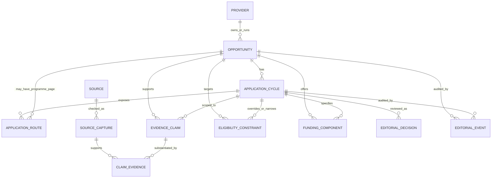

# Scholars Phase 2 — Evidence and Data Model Design

**Date:** 2026-11-08
**Inspected application revision:** `ImperioKDB/Scholars` `main` at `cf3682ce35912df7b9b9352193630fc404427c7c`
**Status:** Proposed conceptual design; not implemented.

## 1. Design goals and boundaries

The design extends, rather than reinterprets, the current scholarship catalogue. It must preserve current IDs, authenticated student workflows, public-page safety, hard/soft eligibility rules, existing notification history, and the distinct `opportunities` catalogue. The system must model reusable programme identity separately from a year/intake, evidence separately from claims, source review separately from application acceptance, and editorial publication separately from authenticity and matching.

The vocabulary below is conceptual. It is not a claim that the listed fields, tables, enums, or relationships currently exist. Migration should be additive and gated by a separate implementation approval.

## 2. Proposed entity map

`SOURCE_CAPTURE` is an immutable record of a particular check/snapshot of a source. A mutable URL registry alone cannot show what content was checked on a past date. `CLAIM_EVIDENCE` is the many-to-many bridge that explains precisely which captured source supports which claim, with support/contradiction/limited-support role.

## 3. Proposed entities and core fields

### Provider

`Provider` is a stable organization identity, not a cycle or listing. Candidate fields: `id`, preferred/display name, aliases, canonical domain, provider-authenticity state, verification basis, created/updated timestamps. Avoid treating a domain match by itself as proof that every linked opportunity is authentic. Provider identity evidence should be represented through source records and claims.

### Opportunity

An enduring programme identity, such as MTN Foundation Scholarship or PTDF In-Country Scholarship. Candidate fields: `id`, provider ID, canonical title, synopsis, opportunity nature/taxonomy, language/region tags, lifecycle (`active`, `inactive`, `merged`/`duplicate` as controlled editorial outcomes), canonical public slug, created/updated timestamps. It should not contain the current cycle’s only deadline or be the only home for route/state.

### ApplicationCycle

One provider-announced instance/intake. Candidate fields: `id`, opportunity ID, provider cycle label, neutral internal cycle key, state, source-backed publication/check references, and dates for opening, deadline, notification, award/disbursement, and optional postponement/cancellation. Each date must record its semantic kind, precision/timezone when supplied, source basis, and whether it is a provider-published date or an editorially derived date. Prefer nullable dates plus explicit state; absence of a date is not zero and must not be filled by annual extrapolation.

Proposed lifecycle values: `unannounced` (no cycle yet, not itself a record of a provider cycle), `upcoming_confirmed`, `open_publicly_presented`, `closed`, `cancelled`, `postponed`, `unresolved`, `conflicting`. “Expired by deadline” may be a derived display condition, but it must not overwrite source history or imply a provider closure notice. Reopened/extended cycles remain the same cycle only when the provider explicitly says so; record the event and keep prior values auditable. An unannounced future cycle should normally be represented as no cycle, not as a fabricated ApplicationCycle row.

### Source and SourceCapture

`Source` registers a URL/source identity and role. Candidate fields: `id`, provider ID (nullable for institutional/secondary sources), canonical URL, source type (`provider_page`, `official_announcement`, `application_form`, `institutional`, `secondary`, `other`), ownership/authority assessment, source purpose, access limitations, and active flag.

`SourceCapture` records a check instance: `id`, source ID, checked timestamp in UTC, final URL/redirect chain, HTTP/access outcome if safely observed, content hash, immutable stored excerpt or restricted snapshot reference, publication date as stated (nullable), retrieval method, freshness state, checker, and limitation note. Never store login credentials or sensitive applicant data in a capture. Access challenges and errors are evidence about access, not evidence that a cycle is open/closed.

### EvidenceClaim and ClaimEvidence

`EvidenceClaim` holds one assertion with scope and time: `id`, opportunity ID, optional cycle ID, claim key/type, normalized value or carefully bounded text, value status (`asserted`, `confirmed`, `contradicted`, `unknown`, `not_applicable`), effective interval/cycle, assessed timestamp, confidence, materiality, reviewer or method, and supersession link. Examples: “Nigerian citizenship required,” “deadline is 2026-11-08,” “applications publicly presented as open,” “accommodation covered.”

`ClaimEvidence` links a claim to one or more captures and records relation (`supports`, `contradicts`, `limits`, `context_only`), quotation/excerpt, location in source, confidence/weight, and reviewer. Claim state must be reviewable without requiring a source to support every other claim. Disputed claims remain as competing evidence/decision history; do not delete the losing source trail.

### EligibilityConstraint

Store eligibility as normalized, cycle-scoped constraints plus an optional provider-original statement. Candidate dimensions include nationality, residence, university country/location, state/LGA/indigene status, host community, gender, level, year of study, course/discipline, GPA scale/minimum, admission status, financial need, institution type, age, and provider-specific requirements. Each constraint needs an operator, normalized value(s), required/optional/conditional flag, applicability/cycle, unknown handling, evidence-claim link, and matching support status.

Do not introduce arbitrary executable expressions or a general-purpose rules engine in the first implementation. Map only to known, typed constraints that can be evaluated safely by `lib/matching/engine.ts`. Unsupported criteria remain visible as “editorially required / not machine evaluated,” and cannot be silently ignored when material. Existing `scholarship_rules` `field/operator/value/gating` semantics should remain the compatibility format until an explicitly tested adapter is approved. Unknown profile data remains unknown; it must not be converted into a positive match.

### ApplicationRoute

Route roles must be distinguishable: programme information page, programme-specific form, third-party host form, generic portal, email/postal channel, closed form, paid-programme route. Candidate fields: cycle ID (nullable for enduring info page), route type/role, exact URL or safely typed non-URL channel, provider ownership/relationship evidence, route state, last reachable check, acceptance state, instruction conflict state, accessibility limitation, route-specific instructions, and source/capture links.

Use separate states for (a) route identity/provenance, (b) observed reachability, and (c) submission acceptance. Never store one `verified_url` boolean as all three. Define a normalized URL allowlist/scheme validator and a safe redirect policy before rendering public links. Route status does not override cycle status.

### FundingComponent and OpportunityNature

Opportunity nature is a controlled classification with extensible records, not a single scholarship/not-scholarship boolean. Proposed values include scholarship, bursary, fellowship, grant, competition, internship, mentorship, paid training, fee-paying academic programme, and other. Funding components are separate rows by benefit and cycle: tuition, accommodation, living stipend, books/materials, transport, examination fees, other. Each has coverage (`full`, `partial`, `fixed_amount`, `reimbursement`, `none`, `unknown`), amount/currency and conditions when evidenced, plus linked claims. “Unknown/unconfirmed” must be a real state, not blank interpreted as fully funded.

For Decagon, store the Foundation scholarship opportunity and Institute paid Honours programme as distinct identities/routes unless fresh evidence proves an explicit relationship; do not copy a scholarship label or funding claim to the paid route.

### EditorialDecision and EditorialEvent

`EditorialDecision` is a versioned, cycle-specific disposition: the seven Phase 1.3.1 dimensions, public-scope target, rationale, resolved/unresolved material issues, effective time, reviewer, approver, and linked evidence claims. `EditorialEvent` is append-only audit history of changes, before/after identifiers/values, actor/system, reason, timestamp, and correlation/idempotency ID. The write that changes a decision and appends its event should be atomic. Automated quality/eligibility analysis is recorded as a machine assessment and never represented as a human approval.

## 4. Dates and freshness

Keep these semantics separate, with UTC timestamps and source-native precision/timezone where relevant:

- `production_snapshot_at`: when the stored production record was inspected; snapshot metadata, not a provider check.
- `official_source_checked_at`: when a specific provider/authoritative source was opened/read.
- `audience_assessed_at`: when eligibility audience claims were evaluated.
- `application_status_assessed_at`: when the exact cycle lifecycle claim was assessed.
- `evidence_published_at`: date explicitly shown by the publisher; null/unknown when absent.
- `captured_at`: when a particular immutable source capture was stored.
- `decision_at`: when an editor approved a disposition.

Freshness states are generic: `fresh_provider_recheck`, `carried_forward`, `mixed_freshness`, `stale`, `not_checked`. Freshness belongs on source capture and/or claim review. A data migration timestamp is not a re-verification date. A current recheck of a source that still displays old-cycle information supports the claim that the page was read now, not that the old opportunity is open now.

## 5. State transitions and decision logic

- **New discovery:** private candidate only → source/provider check → claim extraction → eligibility/cycle/route review → human disposition. No direct candidate-to-public `verified=true` shortcut.
- **Open:** only exact-cycle source evidence plus a current route and confirmed audience/level constraints; human approval required. Route accessibility does not alone cause this transition.
- **Stale:** if a material source/claim freshness interval expires, hold or remove actionable visibility according to risk policy; preserve historical state. Reapproval requires new evidence and human decision.
- **Closed:** explicit provider closure/form closure, or conservative deadline-based inactionability. Preserve whether closure is provider-confirmed versus derived. Stop reminders and actionable match exposure.
- **Contradiction:** preserve both sources; set claim/cycle to `conflicting`, withhold actionable use, assign an owner. Resolution requires fresh evidence or explicitly documented editorial ruling; never average conflicting dates.
- **Inaccessible source:** keep last known verified state with its age and caveat only if policy permits; do not extend actionability beyond its freshness window. Do not infer closure from 403 or opening from login page.
- **New cycle:** create only after provider evidence; link to same enduring opportunity, copy no dates/requirements without revalidation. Prior cycle remains immutable/historical.
- **Extension/reopening/cancellation/postponement:** require explicit official evidence, new claim/capture and reviewer; preserve old date/state in event history; recompute reminders idempotently.
- **Eligibility change:** update only constraints supported by current cycle evidence; invalidate/re-run affected match cache and review any stored editorial decision.

Actionable publication is a conjunctive decision: confirmed authenticity AND adequate audience fit AND undergraduate fit for this catalogue AND exact cycle in `open_publicly_presented` AND acceptable route and acceptance evidence AND fresh support for all material claims AND a human-approved publication decision. Unknown, conflicting, stale, or unsupported dimensions fail closed for application CTAs, reminders, and eligible-match inclusion.

## 6. Worked examples from Phase 1.3.1

| Opportunity/cycle | Evidence-backed model entry | Publication result |
|---|---|---|
| ASUU / FUK 2026 | Authentic branch scholarship; restricted FUK audience; cycle deadline 2026-09-24 noon; branch submission route; closed cycle; no national route claim. | Historical branch cycle or restricted non-actionable lead; no national apply CTA. |
| Bode Amao / 2026? | Authentic provider/form; Nigerian undergraduate audience reported; postal vs email channel conflict; current cycle unresolved. | Manual review; conflicting route claim blocks actionability. |
| Decagon Foundation / current | Foundation and Institute routes kept separate; Foundation scholarship component/coverage unresolved; Institute paid programme and fee claim attached to separate programme/source. | Manual review; do not publish paid Institute route as scholarship. |
| JG Afrika / 2027 | Authentic current bursary form; open publicly presented; citizenship and university location unresolved; notification date not deadline. | Exclude initial Nigerian undergraduate actionable listing pending provider eligibility evidence or approved alternative catalogue. |
| PAU Mastercard / 2026–27 | PAU cycle-specific closed claim conflicts with undated Foundation “Admissions Open” label; separate captures tied to conflict. | Manual review, no open status. |
| NDDC / 2026–27 | Authentic Local Postgraduate call, deadline 2026-11-08; postgraduate-only; portal access anomaly and acceptance unconfirmed. | Excluded from undergraduate catalogue; separately non-actionable while portal status unresolved. |
| PTDF / 2026–27 | Provider-confirmed Nigerian public-university undergrad cycle; window 2026-04-27 to 2026-06-05; closed historical evidence. | Historical archive; no current-cycle inference. |

## 7. Current-to-proposed field mapping (conceptual)

| Existing item | Proposed role | Compatibility rule |
|---|---|---|
| `scholarships.id` | Stable Opportunity identifier during transition | Preserve existing UUIDs; do not recreate or renumber. |
| `title`, `provider_name`, `description` | Legacy/current display snapshot; eventually normalized opportunity/provider fields | Continue serving existing UI until every consumer migrates. |
| `level`, `discipline`, `scholarship_rules` | Current matching inputs; map to typed eligibility constraints | Do not change matching semantics without tests and shadow comparison. |
| `deadline`, `opens_at`, `last_cycle_closed_at` | Legacy cycle projection/cache, not authoritative multi-cycle history | Do not alter production behavior during additive backfill; only populate for a cycle with evidence. |
| `application_url`, `how_to_apply` | Legacy primary route/instructions projection | Keep existing route behavior while new route data is reviewed and dual-read tested. |
| `verified`, `last_verified_at` | Legacy publication gate and ambiguous check timestamp | Do not silently reinterpret. Preserve and map only with explicit provenance; it is not equivalent to the seven dimensions. |
| `research_notes` | Private legacy provenance; migrate only reviewed excerpts/references | Never expose in public projection or treat free text as structured evidence. |
| `cycle_events` | Existing event history useful for migration | Map only events whose semantics and sources are clear; retain originals. |
| `scholarship_discovery_candidate_claims` | Candidate claim staging, not authoritative published Opportunity claims | Promote through an explicit review operation; do not equate candidate `confirmed` with production editorial approval. |

## 8. Implementation prerequisites

Before schema design is finalized: approve public states/copy; choose cycle identity rules; decide freshness intervals; decide exact role/separation-of-duty requirements; specify how unresolved historical records are surfaced; decide whether cycle-specific eligibility overrides opportunity defaults; and review RLS/access boundaries. The schema compatibility audit and decision register identify remaining questions.
